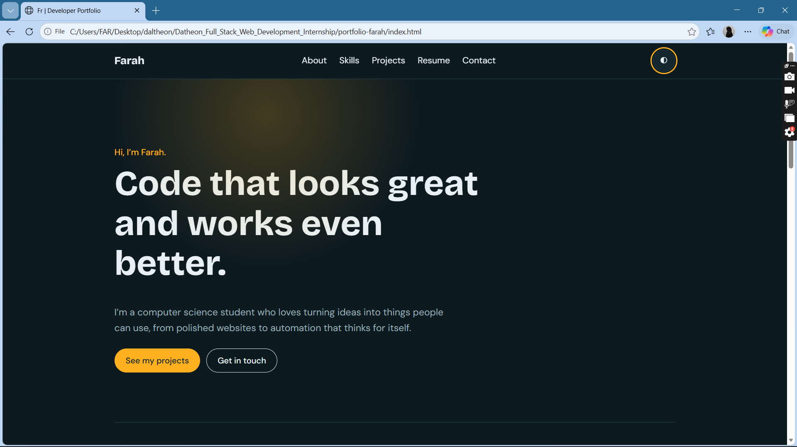
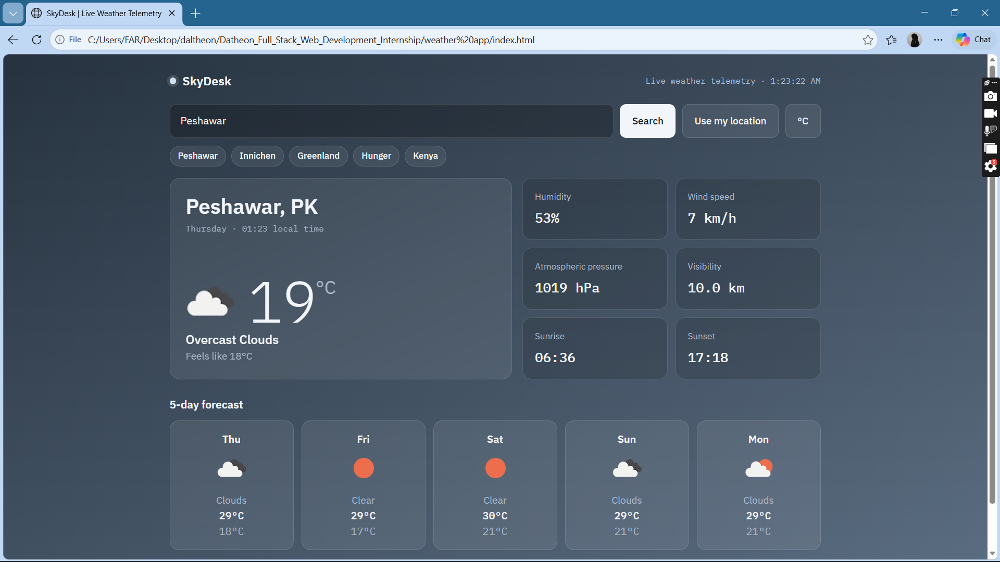

# Datheon Full Stack Web Development Internship

Submission by **Farah Rehman**, Computer Science student.

This repository contains the projects I completed for the Datheon Full Stack Web Development Internship. Each project lives in its own folder and runs directly in the browser, with no build step.

## Tasks Completed

### Task 1: Developer Portfolio
A responsive personal portfolio website that presents my skills, projects and resume.

**Features**
- Dark and light theme toggle
- Mobile navigation menu and smooth scrolling
- Filterable project cards
- Downloadable resume

**Tech:** HTML5, CSS3, JavaScript
**Folder:** `portfolio-farah`
**Live demo:** (https://farah-rehman-bit.github.io/Farah-Rehman-portfolio/)

### Task 3: SkyDesk Live Weather App
A responsive weather dashboard that shows live weather data from the OpenWeatherMap API.

**Features**
- Search any city for temperature, conditions, humidity, wind speed and pressure
- 5-day forecast cards with dynamic weather icons
- Background gradient that changes with the weather and with day or night
- Loading spinner and clear error messages (unknown city, invalid key, no internet)
- °C / °F toggle, location search and recent searches
- Mobile responsive layout

**Tech:** HTML5, CSS3 (Flexbox, Grid), JavaScript (Fetch API, async/await, try/catch)
**Folder:** `weather app`
**Live demo:** (https://farah-rehman-bit.github.io/SkyDesk-Live-Weather-App/)

## Repository Structure

```
Datheon_Full_Stack_Web_Development_Internship/
├── README.md
├── portfolio-farah/
├── weather app/
└── screenshots/
```

## How to Run

1. Download or clone this repository.
2. Open a task folder and double-click `index.html` (Chrome or Edge recommended).
3. **Weather app only:** get a free API key from [OpenWeatherMap](https://home.openweathermap.org/api_keys), paste it into the app and click **Save key**. New keys can take up to two hours to activate. The key is stored only in your browser and is never uploaded to GitHub.

## Screenshots

| Portfolio | Weather App |
|-----------|-------------|
|  |  |

## What I Learned

- How to fetch data from a REST API using `fetch` and `async/await`, and how to handle errors gracefully with `try/catch`.
- How to build responsive layouts with Flexbox and Grid so a page works on both phones and desktops.
- How to keep an API key out of public code, and how to organise and publish projects with Git and GitHub.

## Acknowledgements

Weather data provided by [OpenWeatherMap](https://openweathermap.org). Internship by Datheon.
